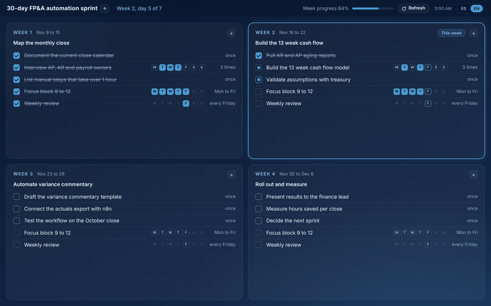
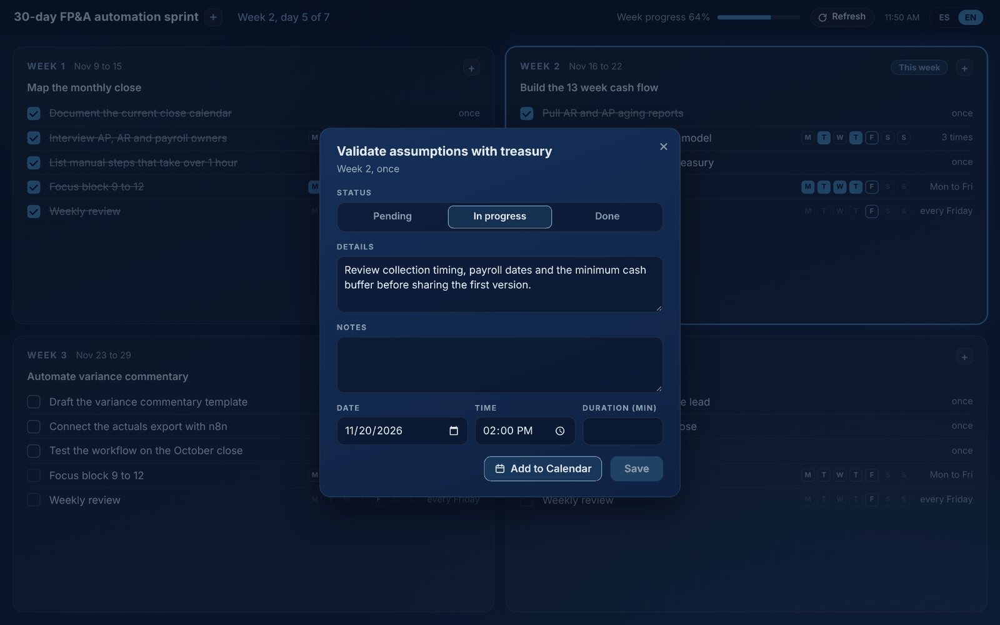

# plan-tracker

Desktop app to track weekly work plans, synced with Google Sheets, Google Calendar and Claude.

It lives on a second screen all day: four weeks at a glance, one line per task, and a check box for every day a habit gets done.



## The problem

A 30 day plan written in a chat or a document is easy to make and easy to forget:

* There is no single place to see what is due this week and what is already done
* Recurring habits (a daily focus block, a weekly review) are hard to track day by day
* Updating the plan means editing a file by hand, and the calendar goes out of sync
* Plans change during the week, and the tracker has to keep up without extra work

## The solution

A small local app that reads the plan from a Google Sheet and shows it as a clean four week board. The sheet is the single source of truth, so the plan can be updated from three places and stay in sync:

* from the app itself (check a task, mark a day, edit notes)
* from any Claude chat, through Claude's Google Sheets connector
* directly in Google Sheets

The board refreshes on its own every 15 seconds, so a change made by Claude in a chat shows up on screen without touching anything.

## What it does

* Four quadrants, one per week, with the current week highlighted and the week's progress at the top
* Two kinds of tasks: one time tasks with a check box, and recurring tasks (daily, Monday to Friday, a fixed weekday, or N times a week) with a box for each day
* Task panel with status, details, notes, date, time and duration
* "Add to Calendar" button that creates or updates the event in Google Calendar and keeps the link in the sheet
* Add a task to any week straight from the board, with its frequency, goal and details
* Several plans in the same sheet, with a selector and a form to create a new plan
* A color palette per plan (six dark palettes: Carolina, Forest, Burgundy, Amber, Violet and Teal), saved in the sheet, so each plan is easy to tell apart at a glance
* Plans longer than four weeks get a "4 weeks / all weeks" switch, saved per plan. The four week view keeps the same size as a four week plan and scrolls one row (two weeks) at a time with scroll snap, always showing four whole weeks and opening on the current week
* The layout adapts on its own: if a week does not fit the window, text and spacing get a little more compact
* Spanish and English interface
* Every change is logged in a `Cambios` tab, with its source (app or Claude)
* Opens in its own window with a double click, and can start with Windows

## Screenshots

| Weekly board | Task panel |
|---|---|
|  |  |

Screenshots use sample data.

## How it works

```
Google Sheet "Plan Tracker"  <---->  Claude chats (Sheets connector)
          ^
          |  Google Sheets API + Google Calendar API (OAuth, desktop app)
          v
Local Flask server (127.0.0.1)  --->  Chrome window in app mode
```

The sheet has six tabs: `Planes`, `Semanas`, `Tareas`, `Marcas` (one row per day a recurring task was done), `Metricas` and `Cambios`. Columns are found by their header name, so the sheet can be read and edited by people and by Claude without breaking the app. Each plan's palette lives in the `color` column of `Planes`, so Claude can also change it from a chat.

## How to use it (Windows)

1. Install Python 3.14 from python.org.
2. In Google Cloud, enable the Google Sheets API and the Google Calendar API, create an OAuth client of type "Desktop app" and save its file as `credentials.json` in this folder.
3. Create the environment and install the libraries:
   ```
   py -3.14 -m venv .venv
   .\.venv\Scripts\python.exe -m pip install -r requirements.txt
   ```
4. Copy `.env.example` as `.env` and fill in `SPREADSHEET_ID` with the id of your sheet.
5. Test the connection: `.\.venv\Scripts\python.exe app\probar_hoja.py`. The first run opens the browser to sign in with Google.
6. Double click `Abrir Plan Tracker.cmd`.

Detailed instructions in Spanish are in `LEEME.txt`.

## Files

| File | Purpose |
|---|---|
| `app/servidor.py` | Local server: serves the page and the read and write endpoints |
| `app/tablero.py` | Builds the board for a plan: current week, progress, frequencies, day boxes |
| `app/hoja.py` | Reads the sheet tabs |
| `app/escritura.py` | Writes changes to the sheet and logs them in `Cambios` |
| `app/calendario.py` | Creates or updates Google Calendar events |
| `app/google_auth.py` | Google sign in (OAuth) |
| `app/lanzador.py` | Starts and stops the app, start with Windows, desktop shortcut |
| `app/static/` | Interface (HTML, CSS, JavaScript) |
| `Abrir Plan Tracker.cmd` | Opens the app |
| `Cerrar Plan Tracker.cmd` | Stops the local server |
| `Arrancar con Windows.cmd` | Turns start with Windows on or off |

`credentials.json`, `token.json` and `.env` stay on the computer and are never uploaded (see `.gitignore`).

## Built with

Python, [Flask](https://flask.palletsprojects.com/), [Google Sheets API](https://developers.google.com/workspace/sheets/api), [Google Calendar API](https://developers.google.com/workspace/calendar/api), and [Claude Code](https://claude.com/claude-code).
